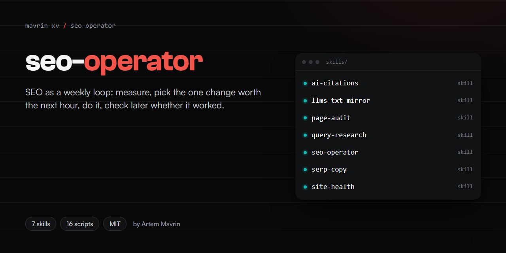
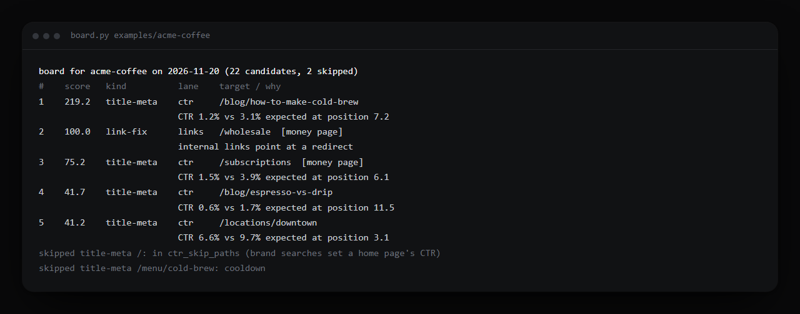

# seo-operator

**SEO for a site you own, run as a weekly loop by Claude Code: it measures, picks the one change worth the next hour, does it, and checks weeks later whether it worked.**

Most SEO help is an audit: sixty findings, no order, and nobody finds out which fixes moved anything. This pack keeps memory per site in plain files, ranks every possible action on one scale (clicks at stake per operator-hour), and keeps a ledger that judges each change against the site-wide trend after 21 days. Around the loop sit the jobs that come up every week: technical probes, titles and descriptions, query research, llms.txt and markdown mirrors, AI citation tracking and a single-page audit.

  



```bash
git clone https://github.com/mavrin-xv/seo-operator && cd seo-operator
./install.sh                 # skills into ~/.claude/skills (or --project for this project only)
```

<!-- install-notes:start -->
Other ways in: as a Claude Code plugin, run `/plugin marketplace add mavrin-xv/seo-operator` and then `/plugin install seo-operator@seo-operator`. For Codex or another agent that reads `SKILL.md`, copy the folders under `skills/` into its skills directory. On Windows, run `install.sh` from Git Bash or WSL and type `py -3` where these docs say `python3`.
<!-- install-notes:end -->

## What it solves

| Pain | What the pack does |
|---|---|
| An audit with 60 findings and no order | One board: every action scored as clicks at stake x share usually recovered / hours, money pages x1.5 |
| "Did that title change work?" Nobody knows | A ledger pins the baseline on the day of the change and judges it after 21+ days against the site trend |
| Every page is up 20% and the fix gets the credit | Verify subtracts the site-wide change before calling anything a win |
| The next session starts from zero | Per-site state folder: config, snapshots, board, ledger, facts, owner to-do |
| robots.txt allows AI bots, the CDN blocks them | Probes each crawler's user agent against a browser request, and reads robots groups per crawler |
| Titles stuffed with keywords or numbers nobody can back up | A lint with hard fails and 30 automatic points; numbers must appear in your facts file |
| A content plan built from ideas | Query buckets, striking-distance queries and autocomplete, filed as NOW, NEXT, HOLD or DROP |
| "Does ChatGPT recommend us?" answered by one screenshot | Dated rounds of fixed prompts, share of model per engine, failed checks kept out of the count |

## What's inside

| Skill | What it does | Say |
|---|---|---|
| [seo-operator](skills/seo-operator/SKILL.md) | The loop: memory, measure, crawl, rank, act, register, verify, report | "do SEO for my site", "what should I fix this week" |
| [site-health](skills/site-health/SKILL.md) | Crawl plus live probes: soft 404, robots groups, edge blocks, JS-only pages, redirect chains, swapped-name pages | "technical SEO audit", "are AI bots blocked" |
| [serp-copy](skills/serp-copy/SKILL.md) | Title and description variants by angle, linted and scored, one shipped and registered | "rewrite the title", "improve CTR" |
| [page-audit](skills/page-audit/SKILL.md) | One page or draft scored GEO 60, SEO 30, brand 10 from counted facts, with exact fixes | "audit this draft", "will ChatGPT cite this" |
| [query-research](skills/query-research/SKILL.md) | Intent buckets, striking distance, autocomplete, a decision queue | "what should we write about", "keyword research" |
| [llms-txt-mirror](skills/llms-txt-mirror/SKILL.md) | llms.txt built from the crawl, markdown mirrors in a fixed layout, both linted | "make an llms.txt", "markdown version of our pages" |
| [ai-citations](skills/ai-citations/SKILL.md) | Cited, mentioned or absent per engine and prompt, compared between rounds | "AI visibility", "share of model" |

Scripts (Python standard library, each with `--help`): `seo_state.py`, `seo_measure.py`, `seo_crawl.py`, `seo_select.py`, `seo_register.py`, `seo_report.py`, `site_probe.py`, `overlap.py`, `serp_lint.py`, `page_facts.py`, `query_buckets.py`, `suggest.py`, `llms_txt.py`, `mirror_lint.py`, `aeo_diff.py`.

## Quick start

1. Export the Pages and Queries tables from Search Console (Performance, last 28 days) as CSV.
2. In Claude Code:
   ```
   > do SEO for acme-coffee.com. Exports are in ~/Downloads/gsc. Money pages: /subscriptions, /wholesale
   ```
3. The agent creates `.seo/acme-coffee/`, measures, crawls, shows the board, does the top action with you, registers it, and writes a report. Next week, say "SEO run for acme-coffee" and it starts by verifying the old actions.

Try it offline on the invented coffee roaster first:

```bash
cd skills/seo-operator/scripts
SEO_STATE_DIR=../../../examples/acme-coffee/state python3 seo_select.py acme-coffee --today 2026-11-20
```

```
board for acme-coffee on 2026-11-20 (22 candidates, 2 skipped)
#    score   kind          lane    target / why
1    219.2   title-meta    ctr     /blog/how-to-make-cold-brew
                           CTR 1.2% vs 3.1% expected at position 7.2
2    100.0   link-fix      links   /wholesale  [money page]
                           internal links point at a redirect
3    75.2    title-meta    ctr     /subscriptions  [money page]
                           CTR 1.5% vs 3.9% expected at position 6.1
...
skipped title-meta /: in ctr_skip_paths (brand searches set a home page's CTR)
skipped title-meta /menu/cold-brew: cooldown
```

Every other example output sits next to its input in `examples/acme-coffee/`.

## How it works

```
 Search Console CSV/API       the live site
          |                        |
     seo_measure              seo_crawl + site_probe
          |                        |
          +------> .seo/<site>/ <--+        config, truth, radar, needs-you
                        |
                    seo_select  -------->  board: clicks at stake x recover / hours
                        |
          act with one skill (serp-copy, page-audit, site-health, ...)
                        |
                  seo_register add  ---->  ledger: baseline + site totals
                        |
           21+ days later: seo_register verify  (vs the site trend)
                        |
                    seo_report  -------->  reports/<date>.md
```

Details: [docs/architecture.md](docs/architecture.md) and [docs/scoring.md](docs/scoring.md).

## Configure

| What | Where |
|---|---|
| Domain, hosts, money pages, brand terms, excluded paths | `.seo/<site>/config.json` (from `templates/config.json`) |
| Thresholds (TTFB, CTR position cap, cooldown, verify wait) | `thresholds` in the same file |
| Your own effort and recovery numbers per action kind | `effort` and `recover` in the same file |
| Facts copy may use | `.seo/<site>/truth.md` |
| State folder location | `--state`, or `SEO_STATE_DIR` (use a relative path in Git Bash), default `./.seo` |
| Search Console API | `GSC_ACCESS_TOKEN` in the environment, then `seo_measure.py --api` |

## Honest limits

- Tested offline only, on the invented site in `examples/acme-coffee/` (a local copy served on 127.0.0.1). The scripts have not been run against a real site's Search Console account by the authors, and the `--api` path was not exercised.
- The expected-CTR curve and the effort and recovery tables are starting guesses, not measurements. Replace them with your own ledger's numbers after about 10 verdicts per kind.
- The crawler is a small stdlib crawler: no JavaScript rendering, a 300-page cap by default, and polite but simple rate handling. Big sites need a real crawler; feed its findings in by hand.
- The edge-block probe sends spoofed user agents. A CDN that verifies crawlers by IP can treat this probe differently from the real crawler; confirm in the CDN's logs.
- AI citation rounds are collected by hand or with an API you already have. No engine was queried while building this pack.
- Search Console's UI export stops at 1,000 rows; large sites need the API.

## Credits

- Operator loop with per-site memory and a verified ledger: the method comes from the authors' own practice; no outside code.
- Technical check coverage and AI crawler handling: inspired by https://github.com/AgriciDaniel/claude-seo (MIT).
- GEO scoring dimensions and citation tracking: inspired by https://github.com/zubair-trabzada/geo-seo-claude (MIT).
- Search Console query patterns: inspired by https://github.com/AminForou/mcp-gsc (MIT).
- llms.txt format: the proposal at https://llmstxt.org and https://github.com/AnswerDotAI/llms-txt (Apache-2.0).
- Title, description and page audit checklists: inspired by https://github.com/coreyhaines31/marketingskills (MIT).
- Repo and skill layout: modelled on https://github.com/anthropics/skills and https://github.com/obra/superpowers (MIT).

Two scripts are adapted from https://github.com/boringmarketer/boring-marketing-skills (MIT, Copyright (c) 2026 Boring Marketing, LLC): `overlap.py` and `suggest.py`. Their headers list the changes; the license is in [THIRD_PARTY_NOTICES.md](THIRD_PARTY_NOTICES.md). From everything else, ideas only; no code was copied.

## Contributing

See [CONTRIBUTING.md](CONTRIBUTING.md). Agents working on the repo: [AGENTS.md](AGENTS.md).

<!-- author:start -->
## Author

Built and maintained by [Artem Mavrin](https://github.com/mavrin-xv). This repo is one of a set of agent skill packs for marketing and operations work. Each one installs on its own; the full list is in [agent-skill-packs](https://github.com/mavrin-xv/agent-skill-packs). If a pack saved you an afternoon, a star helps other people find it.
<!-- author:end -->

## License

MIT. See [LICENSE](LICENSE).
